<p align="center">
  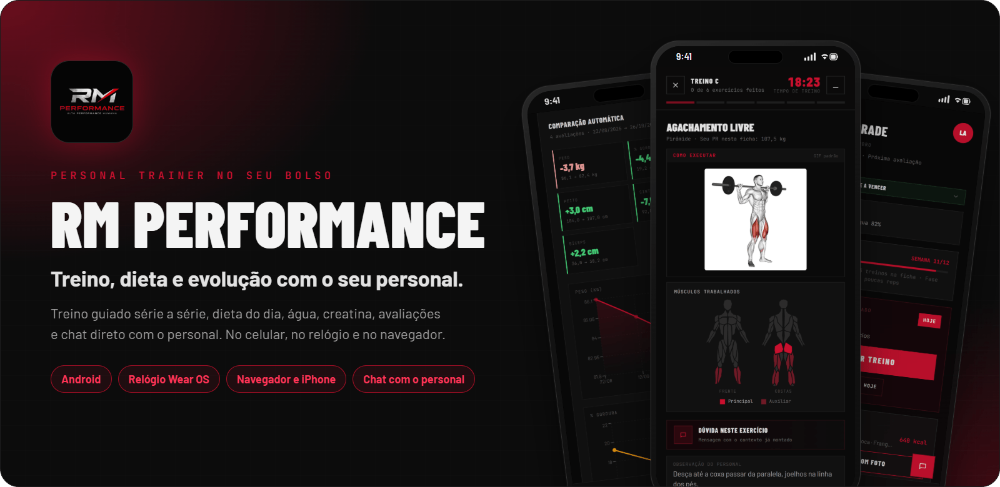
</p>

<p align="center">
  <a href="https://github.com/felipekevinns/rm-performance-releases/releases/latest/download/RM-Performance.apk"></a>
  &nbsp;
  <a href="https://rm-performance.web.app"></a>
  <br>
  <a href="https://github.com/felipekevinns/rm-performance-releases/releases/latest/download/RM-Performance-Watch.apk">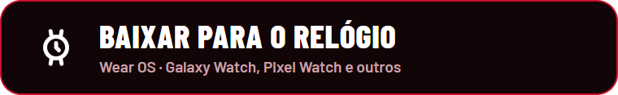</a>
</p>

<p align="center">
  <b>RM Performance</b> é o app que liga você ao seu personal trainer.<br>
  O <b>aluno</b> segue o treino do dia série a série, registra a dieta, a água e a creatina, acompanha a evolução e conversa com o personal.<br>
  O <b>personal</b> monta treinos e dietas, faz as avaliações, acompanha cada aluno em tempo real e controla as mensalidades.
</p>

---

## Sumário

- [Instalar](#instalar)
- [O app avisa e se atualiza sozinho](#o-app-avisa-e-se-atualiza-sozinho)
- [Primeiros passos](#primeiros-passos)
- **Para o aluno**
  - [Início](#início)
  - [Treino](#treino)
  - [Dieta](#dieta)
  - [Evolução](#evolução)
  - [Chat com o personal](#chat-com-o-personal)
  - [Perfil, notificações e conta](#perfil-notificações-e-conta)
- **Para o personal**
  - [Painel do personal](#painel-do-personal)
  - [Alunos e dossiê](#alunos-e-dossiê)
  - [Montar treinos e dietas](#montar-treinos-e-dietas)
  - [Financeiro](#financeiro)
- [Relógio (Wear OS)](#relógio-wear-os)
- [Notificações](#notificações)
- [Planos](#planos)
- [Perguntas frequentes](#perguntas-frequentes)

---

## Instalar

### Android

1. Baixe o APK pelo link fixo, que sempre traz a versão mais nova:
   **[RM-Performance.apk](https://github.com/felipekevinns/rm-performance-releases/releases/latest/download/RM-Performance.apk)**
   (ou em [Releases](../../releases/latest)).
2. Abra o arquivo no celular. Se o Android perguntar, permita **instalar apps desta fonte**.
3. Toque em **Instalar**, abra o app e entre com o e-mail e a senha do seu convite.

> Já tem o app? Instale por cima. Sua conta, seus treinos e sua dieta ficam guardados e nada se perde.
> Depois de instalado, o próprio app avisa quando sai uma versão nova ([veja abaixo](#o-app-avisa-e-se-atualiza-sozinho)).

### Relógio (Wear OS)

Funciona em relógios com **Wear OS 3 ou mais novo** (Galaxy Watch 4 em diante, Pixel Watch e outros). Enquanto o app não está na Play Store, a instalação é feita pela **depuração sem fio** do relógio.

**1. Ligue o modo desenvolvedor no relógio** (só na primeira vez)

1. No relógio: **Configurações → Sobre o relógio → Informações do software**.
2. Toque 5 a 7 vezes seguidas em **Versão do software** até aparecer "Modo de desenvolvedor ativado".
3. Em **Configurações → Opções do desenvolvedor**, ligue **Depuração ADB** e **Depuração sem fio** (em alguns relógios: "Depuração por Wi-Fi").
4. Deixe o relógio no **mesmo Wi-Fi** do celular (ou do computador).

**2. Instale o app (escolha um jeito)**

<details>
<summary><b>Pelo celular, sem computador</b></summary>
<br>

1. No celular, baixe o **[RM-Performance-Watch.apk](https://github.com/felipekevinns/rm-performance-releases/releases/latest/download/RM-Performance-Watch.apk)**.
2. Instale um app que instala APKs no relógio, como o **Wear Installer 2** (Play Store).
3. No relógio, em **Depuração sem fio → Parear novo dispositivo**, aparecem um **código** de 6 números e um **IP:porta**. Digite os dois no app instalador para parear.
4. No app instalador, escolha o arquivo **RM-Performance-Watch.apk** e toque em instalar. Em poucos segundos o RM Performance aparece no relógio.

</details>

<details>
<summary><b>Pelo computador (ADB)</b></summary>
<br>

Com as [Platform-Tools do Android](https://developer.android.com/tools/releases/platform-tools) instaladas, use o IP:porta e o código que o relógio mostra em **Depuração sem fio**:

```bash
adb pair 192.168.0.20:37123 123456      # IP:porta e código de "Parear novo dispositivo"
adb connect 192.168.0.20:41234          # endereço principal da tela (é outra porta)
adb install -r RM-Performance-Watch.apk
```

</details>

**3. Entre com a sua conta**

1. Abra **RM Performance** no relógio: aparece um **código de 6 números** (vale 10 minutos).
2. No celular (app ou site), vá em **Perfil → Relógio**, digite o código e toque em **Continuar**. Confira o nome do relógio e pronto: em instantes ele abre o seu treino.

> **Para atualizar o relógio:** quando sai versão nova, o próprio relógio mostra o card **Atualização** na tela inicial. Toque em **Baixar no celular**: o APK novo abre no celular pareado. Depois, instale por cima pelo Wear Installer, como no passo 2. A conta continua conectada. Depois de instalar, pode desligar a depuração sem fio para economizar bateria.

### iPhone, computador e tablet

Acesse **https://rm-performance.web.app** e entre com a mesma conta.
No iPhone, toque em **Compartilhar → Adicionar à Tela de Início** para abrir como app, em tela cheia.

---

## O app avisa e se atualiza sozinho

<p align="center">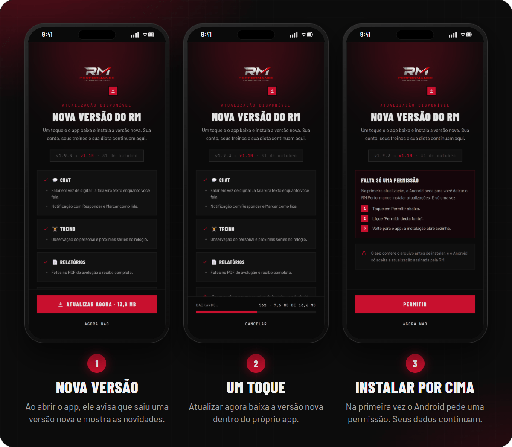</p>

- Ao abrir o app no Android, se saiu uma versão nova, aparece a tela **Nova versão do RM** com as novidades.
- Um toque em **Atualizar agora** baixa a versão nova dentro do próprio app, com barra de progresso.
- Quando termina, abre o instalador do Android. Na **primeira** atualização ele pede para permitir que o RM Performance instale atualizações; depois é só tocar em **Atualizar**.
- O app confere o arquivo antes de instalar, e o Android só aceita a atualização assinada pela RM.
- **Agora não** adia o aviso por algumas horas. Nada se perde: seus dados ficam na sua conta.
- **No relógio**, a instalação não é automática, porque o Wear OS não tem instalador de arquivos. O relógio avisa com o card **Atualização** e abre o download no celular, e você instala com o Wear Installer ([passo a passo](#relógio-wear-os)).

---

## Primeiros passos

<p align="center">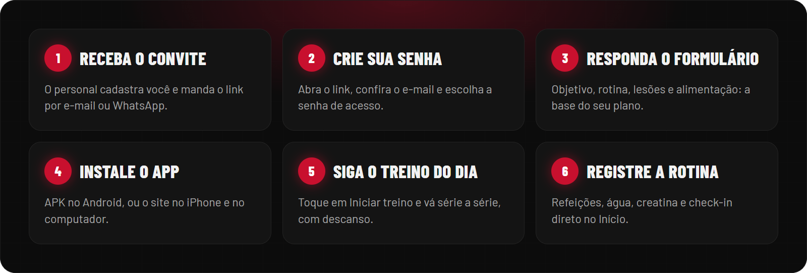</p>

| | O que fazer | Onde |
|:-:|---|---|
| **1** | **Receba o convite** do seu personal, por e-mail ou WhatsApp. O link vale por 48 horas. | E-mail ou WhatsApp |
| **2** | **Crie sua senha** e confirme o acesso. | Link do convite |
| **3** | **Responda o formulário inicial**: objetivo, experiência, lesões, saúde e alimentação. Leva menos de 3 minutos. | Abre sozinho no primeiro acesso |
| **4** | **Instale o app** no Android ou use o site no iPhone e no computador. | [Instalar](#instalar) |
| **5** | **Siga o treino do dia** quando o personal liberar a sua ficha. | **Início → Iniciar treino** |
| **6** | **Registre a rotina**: refeições, água, creatina e check-in. | **Início** e **Nutrição** |

<p align="center">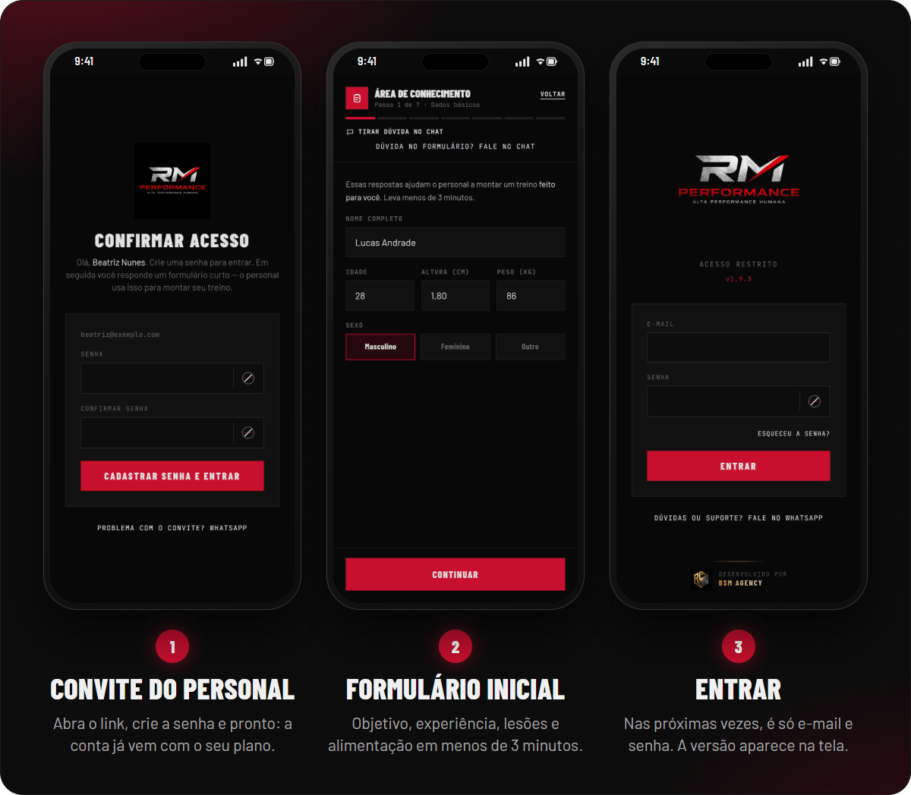</p>

---

## Início

<p align="center">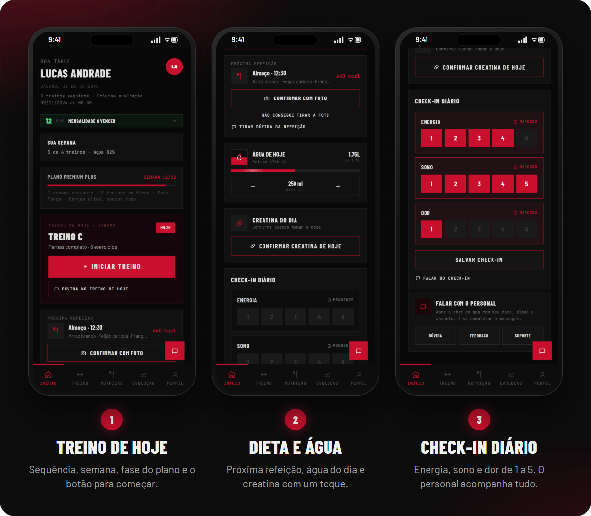</p>

A tela inicial mostra o seu dia de uma vez:

- **Treino de hoje**: a ficha do dia, a sua sequência de treinos, a semana e a fase do plano. Um toque em **Iniciar treino** e você já está na primeira série.
- **Próxima refeição**: o que comer agora, com as calorias. Confirme **com foto** (câmera do app, com data e hora na imagem) ou conte por que não deu para tirar a foto.
- **Água de hoje**: + e − de 250 ml, ou digite outra quantidade. A meta é a que o personal definiu.
- **Creatina do dia**: confirme a dose com um toque.
- **Check-in diário**: energia, sono e dor de 1 a 5. O personal acompanha e pode puxar conversa.
- **Avisos**: mensalidade perto de vencer e próxima avaliação marcada.
- **Falar com o personal**: dúvida, feedback ou suporte, com a mensagem já começada.

---

## Treino

<p align="center">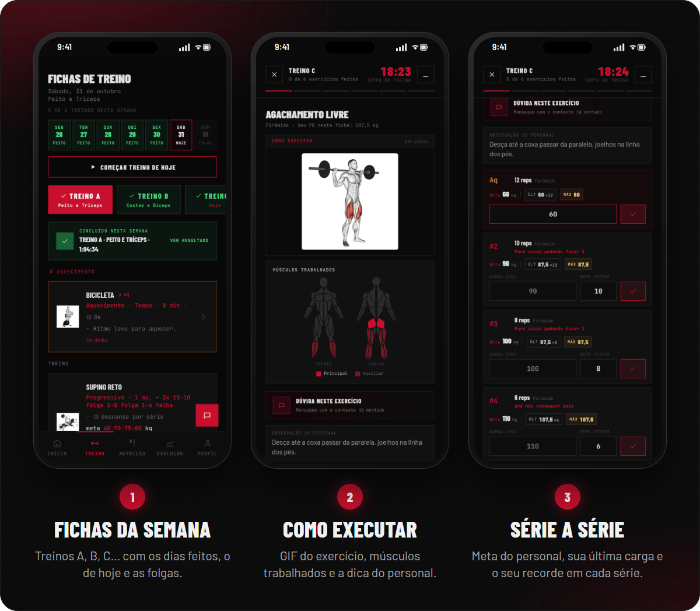</p>

- **Fichas da semana**: treinos A, B, C… com os dias **feitos**, o de **hoje** e as **folgas**. Perdeu um dia? Dá para **repor** depois ou **justificar a falta**.
- **Como executar**: GIF de cada exercício, o desenho dos **músculos trabalhados** e a **observação do personal**. Dúvida? O botão abre o chat já com o exercício.
- **Série a série**: cada série mostra a **meta** do personal, a sua **última carga** e o seu **recorde**. Você só confirma a carga e as repetições que fez.
- **Métodos**: aquecimento, até a falha, reps em reserva ("pare ainda podendo fazer 2"), pirâmide, progressiva, drop-set, rest-pause, bi-set, tri-set, cluster e **exercícios por tempo** (bicicleta, prancha) com cronômetro.

<p align="center">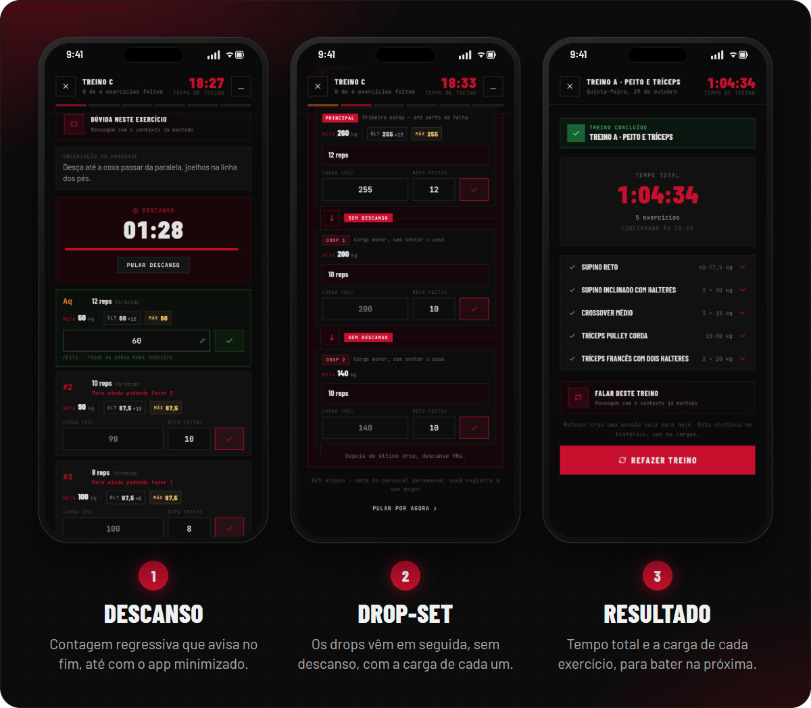</p>

- **Descanso cronometrado** depois de cada série, com aviso no fim. No Android, o tempo de treino e o descanso aparecem na **barra de notificação**, mesmo com o app minimizado.
- **Drop-set**: os drops aparecem em seguida, marcados **sem descanso**, com a carga de cada um.
- **Recordes**: bateu a sua maior carga? O app avisa e o personal fica sabendo.
- **Encerrar e salvar**: teve que parar no meio? O que você fez fica guardado.
- **Resultado**: tempo total e a carga de cada exercício. Dá para **refazer** o treino no mesmo dia sem perder o anterior.
- **Modo treino**: durante o treino, só aparecem as mensagens do personal e o fim do descanso (você escolhe o que liberar).

---

## Dieta

<p align="center">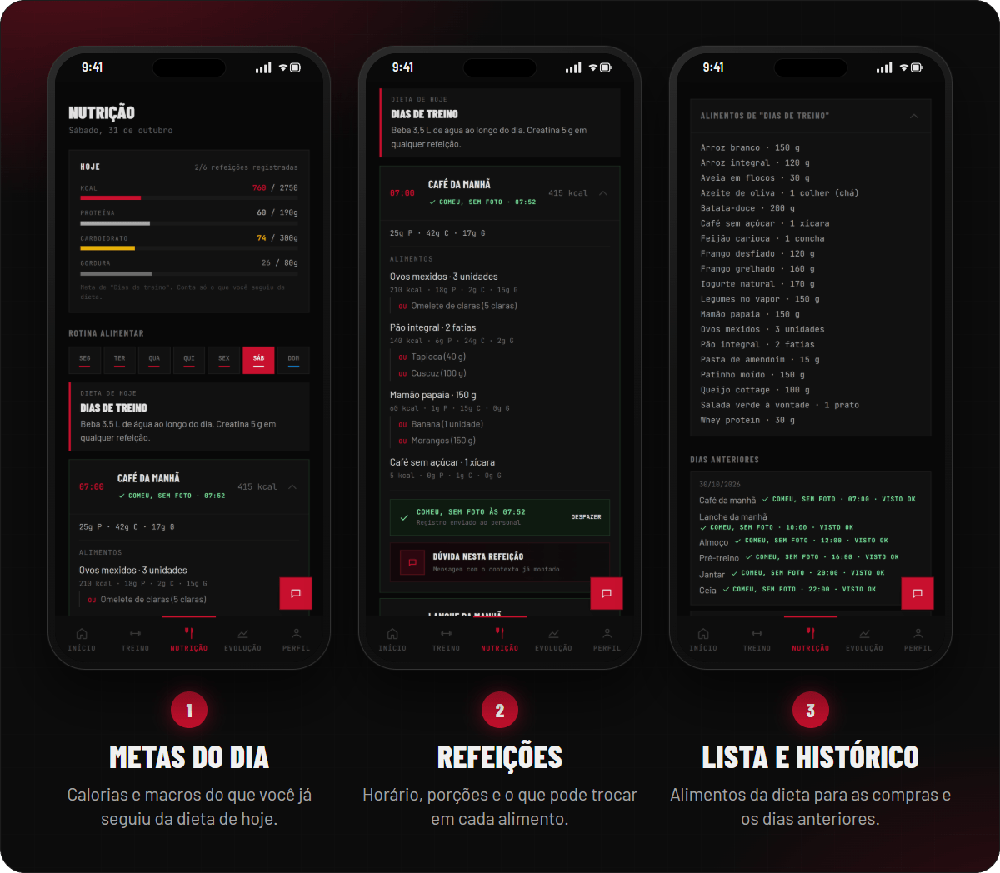</p>

- **Metas do dia**: calorias, proteína, carboidrato e gordura, contando só o que você seguiu da dieta.
- **Rotina por dia da semana**: o personal pode montar uma dieta para os dias de treino e outra para o descanso.
- **Refeições**: horário, alimentos, porções e macros. Embaixo de cada alimento, o que pode **trocar** ("ou tapioca", "ou cuscuz").
- **Confirmar refeição**: com foto, sem foto, "comi outra coisa" ou "pulei". O personal dá o visto ou pede uma revisão.
- **Lista de alimentos** da dieta para as compras e o **histórico** dos dias anteriores.

> Dieta, água e creatina fazem parte do plano **Premium Plus**.

---

## Evolução

<p align="center">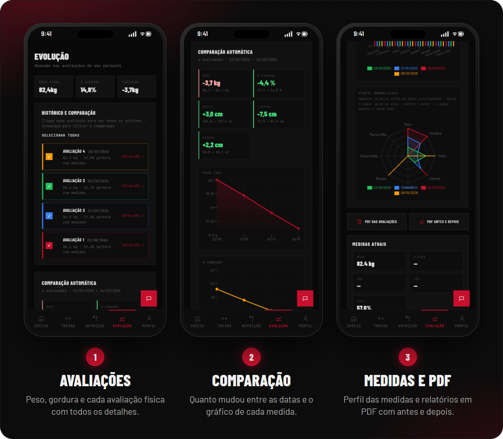</p>

- **Avaliações físicas** feitas pelo personal: peso, % de gordura, dobras, bioimpedância e circunferências.
- **Comparação automática** entre as datas que você escolher: quanto mudou no peso, na gordura, no peito, na cintura, no bíceps…
- **Gráficos** de peso e gordura ao longo do tempo e o **perfil das medidas**.
- **Fotos de evolução** por pose (frente, costas e lados), lado a lado.
- **Relatórios em PDF**: histórico das avaliações e o relatório de evolução com o **antes e depois**.

---

## Chat com o personal

<p align="center">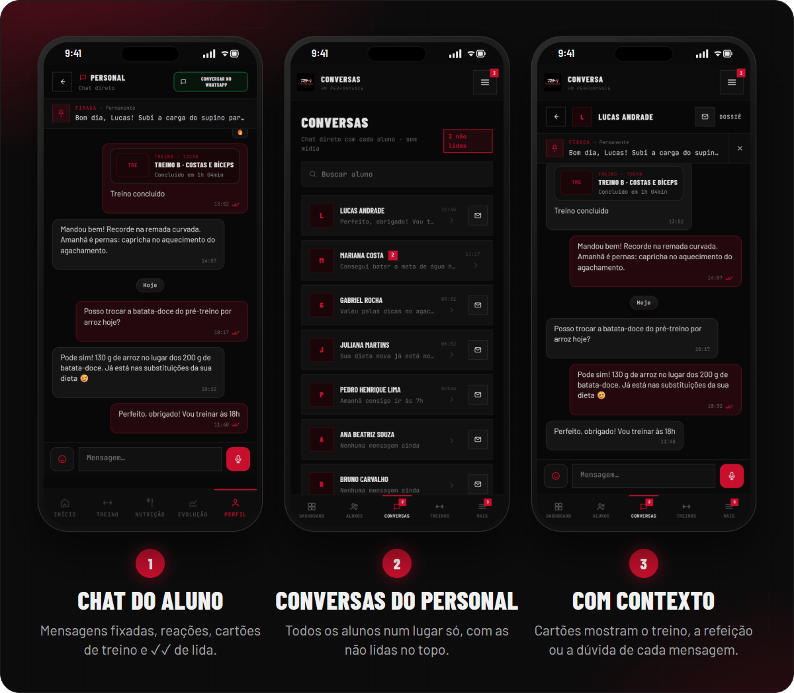</p>

- Conversa direta com o personal, no estilo dos apps de mensagem: **responder**, **reagir**, **editar**, **apagar** e **fixar** mensagens, com ✓ entregue e ✓✓ lida.
- **Falar em vez de digitar**: com o campo vazio, o botão de enviar vira um **microfone**. A sua fala vira texto no campo; você confere e envia. Nenhum áudio é gravado nem enviado, só o texto.
- **Cartões de contexto**: a dúvida já chega com o treino, o exercício, a refeição ou a avaliação de onde veio. Tocar no cartão abre a tela certa.
- **Notificação com Responder** e **Marcar como lida**, sem abrir o app.

---

## Perfil, notificações e conta

<p align="center">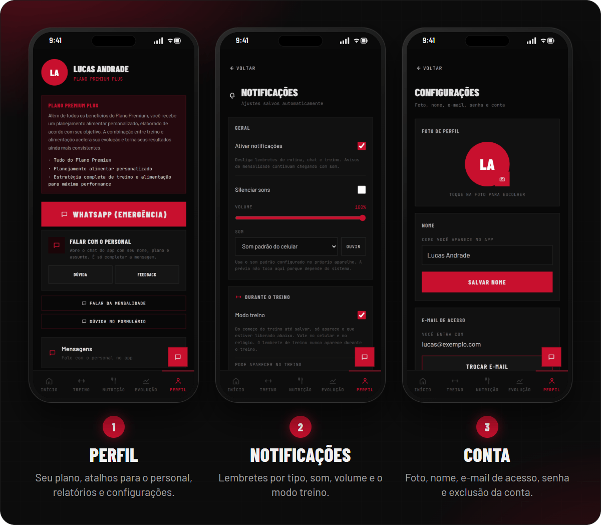</p>

- **Perfil**: seu plano, atalhos para falar com o personal, PDFs de avaliação e de evolução e o **relógio** conectado.
- **Notificações**: liga e desliga cada lembrete, com **som** e **volume** por tipo, e o **modo treino**.
- **Conta**: foto de perfil, nome, **trocar o e-mail de acesso** (com código enviado ao e-mail novo), trocar a senha, **esqueci minha senha** e **excluir minha conta**.

---

## Painel do personal

<p align="center">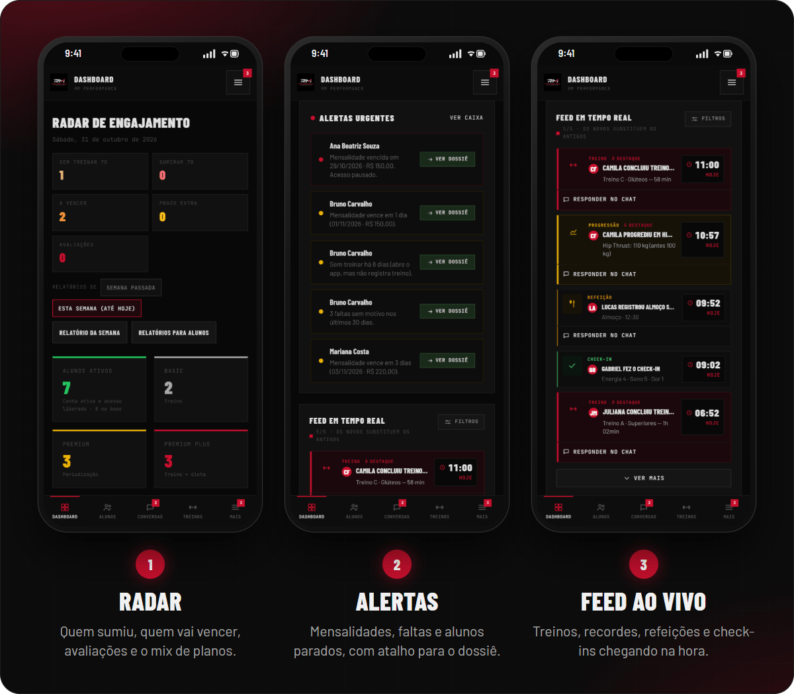</p>

- **Radar de engajamento**: quem está sem treinar, quem sumiu, mensalidades a vencer, prazos extras e avaliações a fazer.
- **Alertas urgentes**: mensalidade vencida, faltas sem motivo e alunos parados, com atalho para o dossiê.
- **Feed em tempo real**: treinos concluídos, recordes, refeições, água e check-ins chegando na hora. Responda no chat direto do feed.
- **Relatório da semana** pronto para mandar no WhatsApp, geral ou por aluno.

## Alunos e dossiê

<p align="center">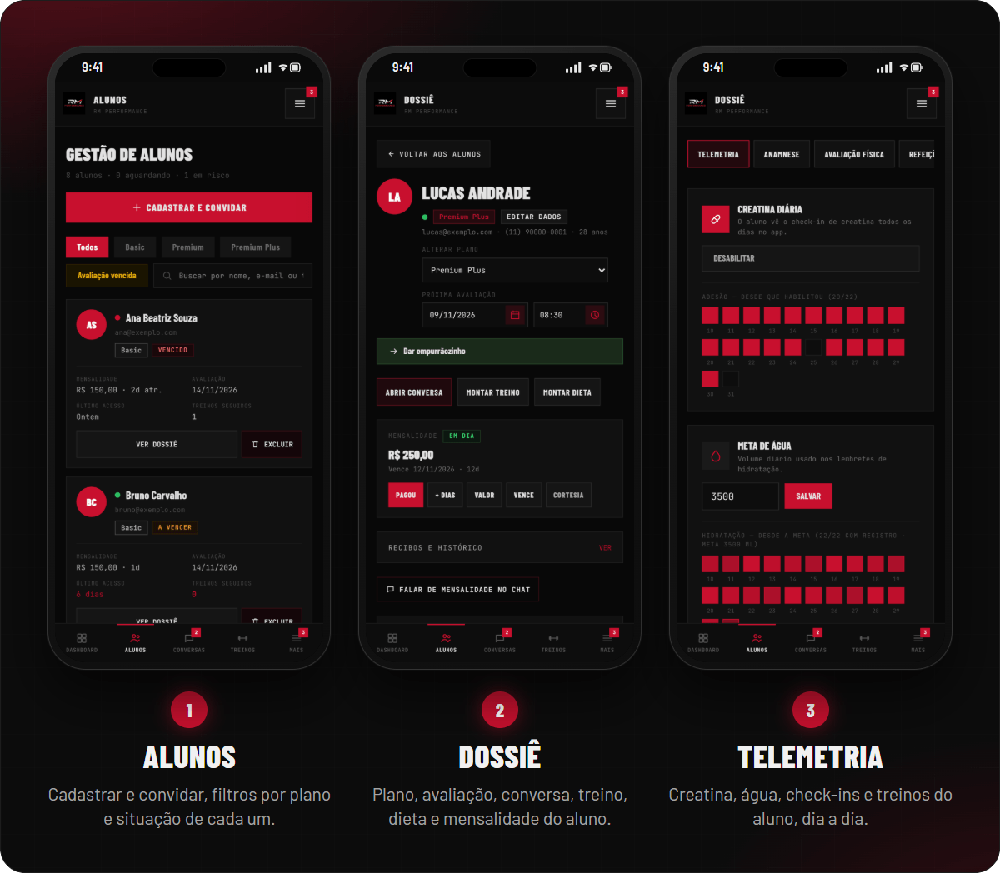</p>

- **Cadastrar e convidar**: o aluno recebe o link por e-mail ou WhatsApp e entra já com o plano certo.
- **Lista de alunos** com filtros por plano e avaliação vencida, busca e a situação da mensalidade.
- **Dossiê** de cada aluno: plano, próxima avaliação, conversa, treino, dieta e mensalidade num lugar só.
- **Telemetria**: treinos, check-ins, água e creatina dia a dia; **anamnese**; **avaliação física** (dobras, bioimpedância, circunferências e fotos por pose); refeições com foto e vídeos de execução.
- **Notas internas e tarefas** que só o personal vê.

## Montar treinos e dietas

<p align="center">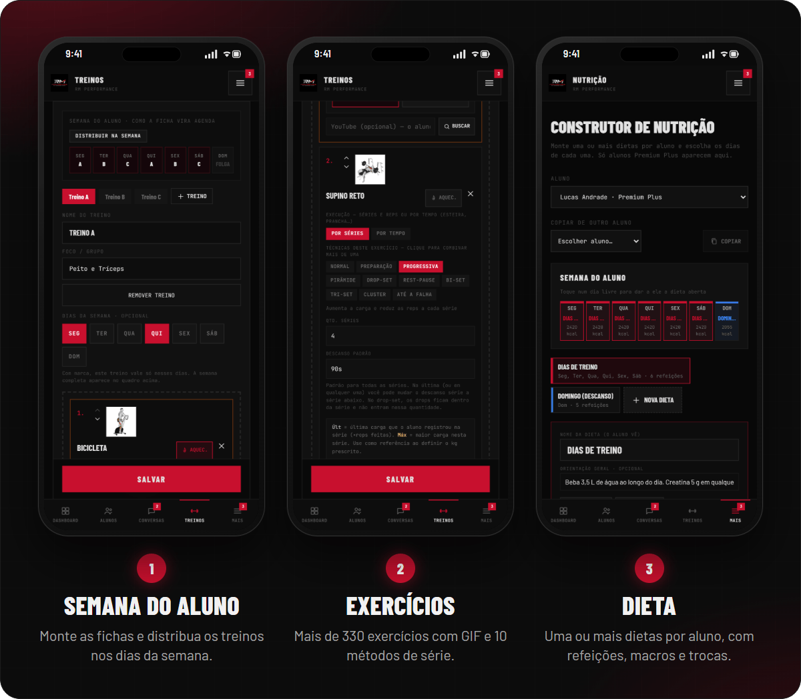</p>

- **Construtor de treinos**: banco com **mais de 330 exercícios com GIF**, **10 métodos de série**, carga, reps e reps em reserva **por série**, aquecimento, exercícios por tempo e vídeo próprio de demonstração.
- **Semana do aluno**: distribua os treinos nos dias e veja como a ficha vira agenda.
- **Periodização** por fases e **templates** para reaproveitar em outros alunos.
- **Construtor de dieta**: uma ou mais dietas por aluno, refeições por dia da semana, macros sugeridos, substituições e cópia de dieta entre alunos.

## Financeiro

<p align="center">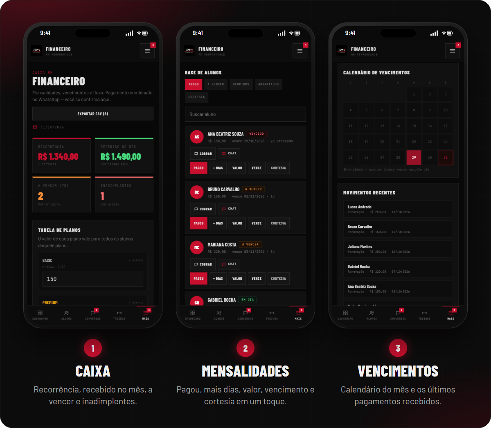</p>

- **Caixa**: recorrência, recebido no mês, a vencer e inadimplentes.
- **Mensalidades**: **Pagou**, **+ dias** de prazo, **valor**, **vencimento** e **cortesia** em um toque. Errou? Dá para **desfazer** um pagamento.
- **Recibos em PDF** numerados, com valor por extenso e os dados do personal, prontos para compartilhar.
- **Calendário de vencimentos**, movimentos recentes, fluxo de caixa, mix de planos e **exportação para planilha (CSV)**.
- **Tabela de planos**: o valor de cada plano vale para todos os alunos daquele plano.

---

## Relógio (Wear OS)

<p align="center">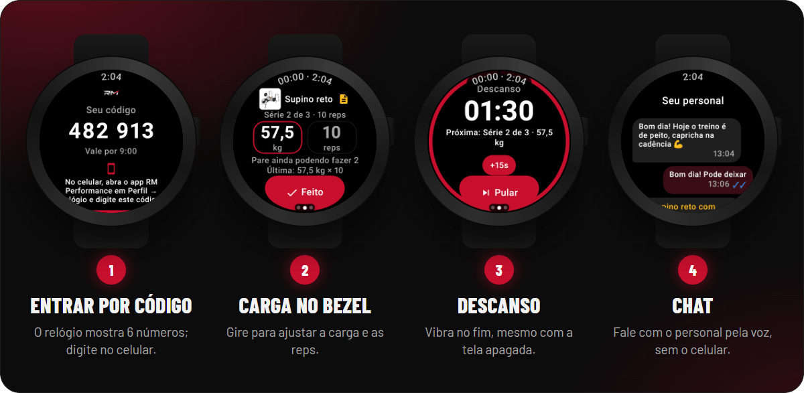</p>

O treino no pulso, **sem precisar do celular por perto** (relógio com LTE ou no Wi-Fi). Sem internet, o que você registra fica no relógio e sobe sozinho quando a conexão volta.

| Tela | O que faz |
|---|---|
| **Entrar por código** | O relógio mostra 6 números; digite em **Perfil → Relógio** no celular. Sem e-mail e senha no pulso. |
| **Treino guiado** | Série a série, com a carga e as reps ajustadas girando o **bezel** ou a coroa. Aquecimento, drop-set sem descanso, reps em reserva, exercícios por tempo e recorde. |
| **Descanso** | Contagem regressiva que **vibra no fim**, mesmo com a tela apagada. Batimentos ao vivo durante o treino. |
| **Celular + relógio juntos** | Começou num, continua no outro: as séries confirmadas aparecem nos dois. |
| **Detalhes do exercício** | Observação do personal, todas as séries, GIF e músculos trabalhados. |
| **Dieta, água e creatina** | Refeições do dia com porções e trocas, água (+250 ml) e creatina no Início. |
| **Chat** | Mensagens do personal no relógio, **resposta por voz**, teclado, emoji ou respostas rápidas. |
| **Bloco "RM · Hoje"** | Treino do dia, próxima refeição e água direto do mostrador. |

Ficam só no celular: foto das refeições, check-in, avaliações e evolução.

---

## Notificações

| Lembrete | Quando chega |
|---|---|
| **Treino** | No horário que você escolher, nos dias de treino |
| **Refeições** | No horário de cada refeição da dieta |
| **Água** | Ao longo do dia, até bater a meta |
| **Suplemento** | Lembrete diário da creatina |
| **Fim do descanso** | Durante o treino, quando o descanso acaba |
| **Mensagens do personal** | Na hora, com Responder e Marcar como lida |
| **Avisos do personal** | Treino ou dieta atualizados, refeição para revisar, avaliação registrada, pagamento confirmado |
| **Avaliação e mensalidade** | Antes da data marcada e do vencimento |

Cada tipo tem liga/desliga, som e volume próprios em **Perfil → Notificações**. O personal também recebe avisos dos alunos (treinos, recordes, refeições, mensagens) e escolhe quais quer.

---

## Planos

| Plano | O que libera para o aluno |
|---|---|
| **Basic** | Treino guiado, fichas, cargas e chat com o personal |
| **Premium** | Tudo do Basic, mais **periodização**, **evolução** e **check-in diário** |
| **Premium Plus** | Tudo do Premium, mais **nutrição**: dieta, refeições com foto, água e creatina |

O plano e o valor são combinados com o seu personal.

---

## Perguntas frequentes

<details>
<summary><b>Como eu crio a minha conta?</b></summary>
<br>
A conta é criada pelo seu personal. Ele cadastra você e manda um link de convite por e-mail ou WhatsApp. Abra o link, crie a sua senha e responda o formulário inicial. O link vale por 48 horas; se venceu, peça um novo ao personal.
</details>

<details>
<summary><b>Esqueci a minha senha. E agora?</b></summary>
<br>
Na tela de entrada, toque em <b>Esqueceu a senha?</b> e use o código enviado para o seu e-mail. Logado, também dá para trocar a senha em <b>Perfil → Configurações</b>.
</details>

<details>
<summary><b>O Android diz que o app é de fonte desconhecida.</b></summary>
<br>
É normal para apps instalados fora da Play Store. Permita <b>instalar apps desta fonte</b> só para o navegador ou o gerenciador de arquivos que abriu o APK. Na primeira atualização pelo próprio app, o Android pede a mesma permissão para o RM Performance.
</details>

<details>
<summary><b>Como eu atualizo o app?</b></summary>
<br>
O app avisa sozinho quando sai uma versão nova: toque em <b>Atualizar agora</b>. Se preferir, baixe pelo link fixo <a href="https://github.com/felipekevinns/rm-performance-releases/releases/latest/download/RM-Performance.apk">RM-Performance.apk</a> e instale por cima. Não precisa desinstalar.
</details>

<details>
<summary><b>Troquei de celular. Perco os meus treinos?</b></summary>
<br>
Não. Tudo fica na sua conta: treinos, cargas, dieta, avaliações e conversas. Instale o app no celular novo e entre com o mesmo e-mail e senha.
</details>

<details>
<summary><b>Tenho iPhone. Consigo usar?</b></summary>
<br>
Sim, pelo site <a href="https://rm-performance.web.app">rm-performance.web.app</a>. No Safari, toque em <b>Compartilhar → Adicionar à Tela de Início</b> para abrir como app. O app de relógio é só para Wear OS.
</details>

<details>
<summary><b>O microfone do chat grava a minha voz?</b></summary>
<br>
Não. A fala é transformada em texto e aparece no campo para você conferir. Só o texto é enviado; nenhum áudio é gravado nem enviado.
</details>

<details>
<summary><b>Perdi o relógio. Como tiro ele da minha conta?</b></summary>
<br>
No celular, vá em <b>Perfil → Relógio</b> e toque em <b>Desconectar</b> ao lado do relógio. Ele sai da sua conta na hora.
</details>

<details>
<summary><b>Quem vê as minhas fotos e informações?</b></summary>
<br>
Só você e o seu personal. Fotos de refeição viram apenas um registro em texto depois de 15 dias. Se quiser, você pode excluir a sua conta e todos os seus dados em <b>Perfil → Configurações → Excluir minha conta</b>.
</details>

<details>
<summary><b>Sou personal. Como começo?</b></summary>
<br>
Entre com a conta de personal, cadastre o aluno em <b>Alunos → Cadastrar e convidar</b> e mande o convite. Depois monte o treino em <b>Treinos</b> e, no Premium Plus, a dieta em <b>Nutrição</b>. Feed, alertas e mensalidades aparecem no <b>Painel</b>.
</details>

---

<p align="center">
  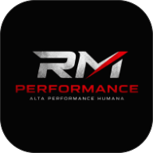<br>
  <b>RM Performance</b> · feito por Felipe Kevin<br>
  <sub>As telas mostradas acima usam dados fictícios.</sub>
</p>
